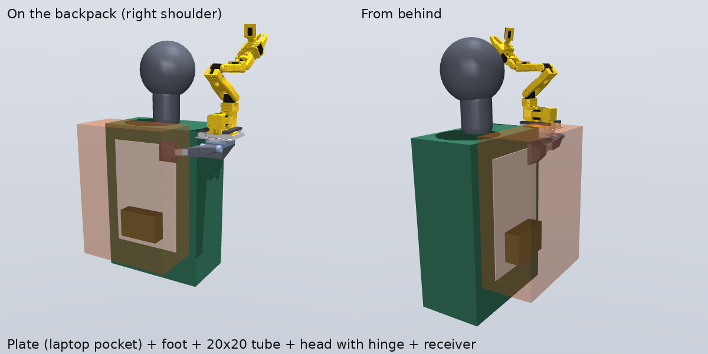

# Argus

An SO-101 arm with a camera that **sees, reacts and holds things**: on the desk and on a backpack,
over the shoulder. Like the hundred-eyed giant, it looks around while you walk.

## Arm with a camera (SO-101): simulation on the desk and on the backpack

An **SO-101** arm (6 Feetech STS3215 servos, LeRobot project) with a wrist camera that
**sees, reacts and holds things**. Simulated first on the desk and then on the backpack, over the
shoulder, while the person walks.

The arm model is the official one from [MuJoCo Menagerie](https://github.com/google-deepmind/mujoco_menagerie/tree/main/robotstudio_so101)
(Apache 2.0). It is not copied into the repo: it is downloaded automatically the first time, into `third_party/`.

## Demo 1: search for, greet and track a person

[Video](media/track_person.mp4). The arm **only uses the image from its camera** (a simple skin
detector instead of a face detector) and its own joint angles, like the real robot:

- **search:** turns from side to side until it sees a face;
- **greet:** nods with the wrist when it finds one;
- **track:** keeps it in the centre of the image, with the horizon level.

The person moves, comes closer, stands up, leaves the room and comes back from the other side.

| Result | |
|---|---|
| Gaze error while tracking | median **2.7°**, p90 6.3° |
| Greetings | 2 (at the start and when the person comes back) |
| Max torque | **1.17 N·m** (the 7.4 V servos are enough, limit 1.91 N·m) |

## Demo 2: grasp, show, hold and put back

[Video](media/grasp_and_hold.mp4). A scripted sequence with inverse kinematics: it comes down with
the gripper vertical, grasps the cube, shows it to the person (30 cm forward, 24 cm high), holds
it for 4 s and puts it back on the desk.

How much weight it can take in the "show" pose (torque of the most loaded servo while holding):

| Mass | 7.4 V servos (1.91 N·m) | 12 V servos (2.94 N·m) |
|---|---|---|
| 30 g | 0.56 N·m ✔ | 0.56 N·m ✔ |
| 100 g | 0.76 ✔ | 0.77 ✔ |
| 200 g | 1.05 ✔ | 1.05 ✔ |
| 300 g | 1.34 ✔ | 1.36 ✔ |
| 400 g | 1.64 ✔ (86 %, at the limit) | 1.67 ✔ |
| 600 g | ✘ drops it | 2.26 ✔ (77 %) |

To hold something **for a while** it is better to stay below ~50 % of the max torque (the servos
heat up): **~150 g at 7.4 V** and **~300 g at 12 V** with the arm stretched out like this. Closer
to the body, it can take quite a bit more.

## Demo 3: on the backpack, over the shoulder, walking

[Looking video](media/backpack_look.mp4) · [holding video](media/backpack_hold.mp4)

The arm sits on a mount over the right shoulder of the backpack. The person walks along a sidewalk
at 4.3 km/h with the real sway of the gait (bobs up and down ~2 cm at 1.8 steps/s, sways and turns
a little). The backpack is "welded" to the body with a stiff spring, so the arm receives the real
accelerations. There are three people on the sidewalk.

**Where the mount goes:** at the edge of the shoulder (26 cm to the side of the centre of the
head), at shoulder height. Further in, the arm ends up less than 10 cm from the head.

**Safety (always on):** the base does not turn towards the head, and if any part of the arm comes
within 10 cm of it, the arm goes back to the rest posture. In the test, the closest it came was
9.8 cm.

### Looking at people while you walk

| Gaze error (median / p90) | No prediction | With prediction |
|---|---|---|
| No IMU | 9.3° / 22.6° | 3.5° / 14.5° |
| **With IMU** | 10.4° / 21.4° | **2.8° / 8.0°** |

- **IMU on the mount** (BNO055): measures the sway and the servos compensate for it.
- **Prediction:** from two consecutive detections it estimates where the person is moving in the
  image. When walking past someone, their direction turns quickly (~0.7 rad/s) and without this
  the gaze lags behind.
- With both, it looks almost as well while walking as standing still (2.8°). Max torque 1.38 N·m:
  the 7.4 V servos are enough.

### Holding something while you walk

A 4 x 4 x 6 cm box held at chest and face height, 28 cm in front of the shoulder, for 17 s of
walking. **Decision:** the arm never holds the phone (it could drop it or it could get stolen);
only light things of no value, such as a small bottle or a flashlight.

| Mass | Torque (most loaded servo) | Slipped | Force / moment on the mount |
|---|---|---|---|
| 50 g | 0.6 N·m | 3 mm | 9 N / 1.3 N·m |
| 100 g | 0.76 | 3 mm | 10 N / 1.5 N·m |
| 200 g | 1.08 | 5 mm | 11 N / 1.9 N·m |
| 300 g | 1.40 | 6 mm | 13 N / 2.4 N·m |
| 400 g | 1.73 | 7 mm | 14 N / 2.8 N·m |
| 500 g | 1.91 at 7.4 V (at the limit) · 2.06 at 12 V | 7–8 mm | 16 N / 3.3 N·m |

- To hold something for a while (less than ~50 % of the max torque): **~150 g at 7.4 V** and
  **~300 g at 12 V**.
- The box is shaken at ~3.5 m/s² (a third of gravity) by the sway of the gait.
- **The mount** has to take ~16 N and ~3.3 N·m in the worst case: with margin, design it for
  **6–7 N·m**.

## The mount (desk and backpack)

Full design in **[cad/README.md](cad/README.md)**: parts to print, what to buy and how it goes
together. The same joint (cradle with a 38 mm dovetail rail + receiver with a knob) works on the
desk and on the backpack: the arm moves from one to the other in seconds.

<p>

</p>

On the backpack: a rigid plate in the laptop pocket, an aluminium tube over the shoulder and a
**hinge with magnets** that lets the arm fold backwards if it gets snagged (never towards the
head). The simulation uses the same dimensions as the CAD (a test checks it).

**Improved fixed head:** a [generative-design trial](generative/README.md) showed that the magnet
platform was flexible; ribs were added by hand and it is now **3 to 4 times stiffer** (+~20 g),
with no extra supports when printing (details in [cad/README.md](cad/README.md)).

**Snagging a branch** at 1.74 m while you walk ([video](media/backpack_branch.mp4)):

| | With hinge | Rigid mount |
|---|---|---|
| Hit on the arm | **39 N** | 248 N |
| Load on the wearer's shoulder | **106 N, 24 N·m** | 262 N, 58 N·m |
| The arm | folds 92° backwards and stays there | the branch bends it, by force |

With a branch at 1.78 m something similar happens (57 N against 190 N on the arm). If the hit is
at shoulder height (1.62 m), the hinge is not enough: the folded arm is still in the way.

**Tight or loose backpack:** with the straps loose, the p90 camera error goes from 8° to 19°. The
mount does not replace a good fit: chest strap and hip belt.

## What we learned from simulating

- The wrist camera is mounted at ~30° from the gripper and off to the side: the rest posture has to
  keep it upright (wrist roll −90°) or the image comes out upside down.
- **Limiting the acceleration** of the servos (10 rad/s²) lowered the max torque from 2.94 to
  1.17 N·m: the peaks came from abrupt starts, not from the weight.
- **The gripper must not squeeze at full force**: it was limited to ~0.8 N·m (~10 N of grip). With
  full torque it crushes the object against the palm and lets it go.
- With the gripper vertical and up high, the wrist reaches its limit: it is better to grasp from
  above and show the object facing forward.

## Usage

```bash
cd sim
pip install -r ../requirements.txt
python demo_track.py                       # search / greet / track (prints results)
python demo_track.py --video track.mp4     # with video
python demo_hold.py --mass 0.2 --volts 7.4V --video hold.mp4
python demo_walk.py                        # on the backpack: look while walking (with and without IMU)
python demo_walk.py --hold                 # on the backpack: hold while walking (masses and voltages)
python -m pytest -q                        # tests (13)
```

On a headless server, prefix with `MUJOCO_GL=osmesa` (or `egl`).

Files:
- `sim/scene.py` — downloads the model, builds the desk, objects and the person
- `sim/control.py` — inverse kinematics, camera tracking, detector
- `sim/demo_track.py`, `sim/demo_hold.py` — the desk demos
- `sim/backpack.py` — backpack scene: walking wearer, mount, IMU, sidewalk with people
- `sim/demo_walk.py` — backpack demos (look and hold while walking, safety)
- `sim/test_arm.py` — tests

## Next steps

1. **More realism:** a real face detector (e.g. MediaPipe's, or a YOLO on the NPU of the
   Orange Pi 5 Pro) on the simulated image, and grasping objects located with the camera.
2. **Voice:** questions and answers with a vision-language model using the camera image.
3. **Print the rail coupons** and measure the real SO-101 base before printing the rest.
4. **Buy** according to **[BOM.md](BOM.md)**, in phases: desk ~250 €, backpack ~170 €, voice ~40 €.
