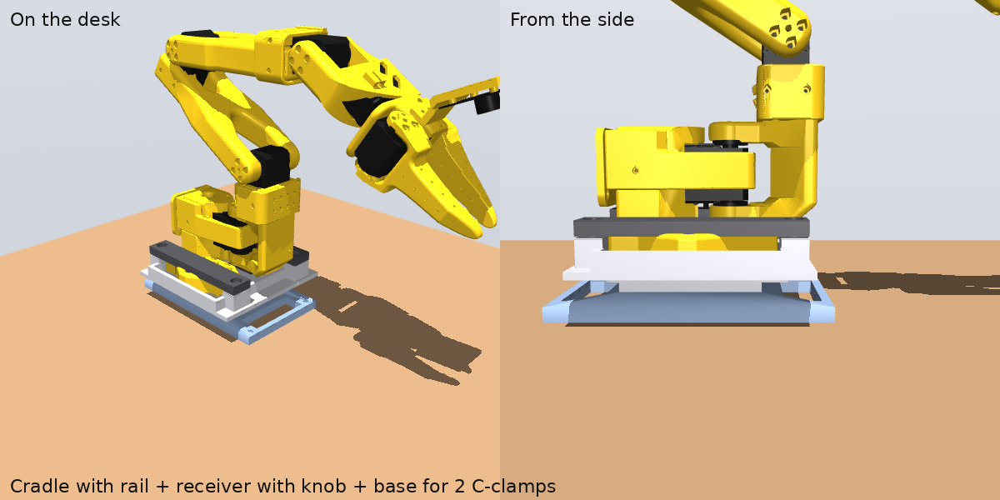
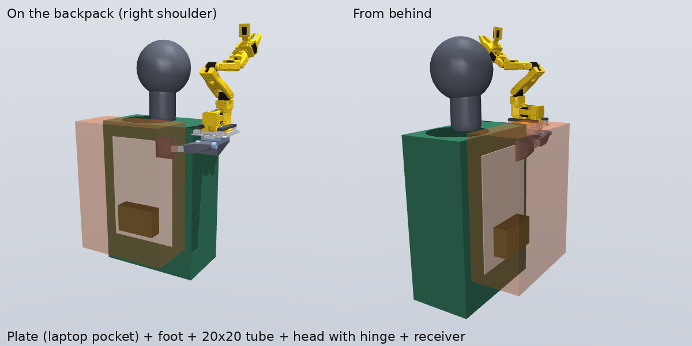
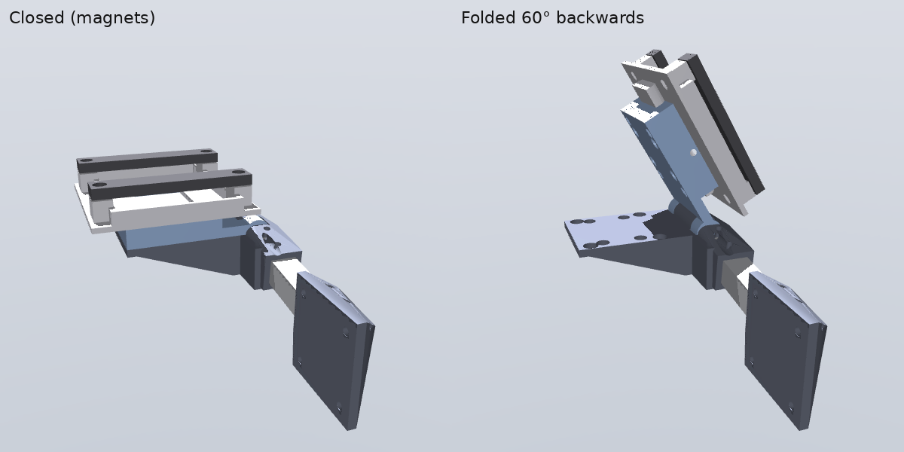

# SO-101 arm mount: desk and backpack (OpenSCAD)

A single kind of joint for everything: the arm base sits in a **cradle with a 38 mm dovetail
rail** (Arca-type), and the rail slides into a **receiver** with a knob. The receiver is on the
desk base and on the head of the backpack mount: the arm moves from one to the other in seconds,
without tools.





## Parts to print

PETG, 0.2 mm layers, **6 perimeters, 40 % infill** (gyroid). Clearance `CL = 0.4 mm` in
`params.scad` (lower it to 0.3 if the printer is accurate). Masses estimated with those settings
(thin walls come out almost solid): ~760 g of PETG in total, ~290 g for the desk and ~470 g more
for the backpack.

Print `head_fixed` with the magnet face on the bed (it is the flat bearing face): the ribs grow
upwards without supports.

| Part | For | Approx. mass | Printing notes |
|---|---|---|---|
| `cradle` | all | 115 g | hugs the base flange (87 x 111 mm); rail underneath; trapped M5 nuts |
| `clamp_bar` (x2) | all | 36 g | clamp the wings of the flange (with 1 mm rubber or TPU underneath) |
| `receiver` | desk | 50 g | fixed jaw + pocket for the moving one + end stop |
| `jaw`, `knob` | desk and backpack | 11 g | the jaw is pushed by an M5 screw with a knob |
| `desk_base` | desk | 91 g | wings for two C-clamps, or 4 screws into the desk |
| `mast_foot` | backpack | 72 g | bolted to the back plate, top right |
| `head_fixed` | backpack | 124 g | grips the tube; central hinge knuckle; support with magnets and stop, with **ribs underneath** (see below) |
| `head_moving` | backpack | 95 g | carries the receiver; side knuckles; magnets |
| `box`, `lid` | backpack | 159 g | Orange Pi 5 Pro, 3S battery, 5 V converter, stop relay |
| `rail_coupon`, `receiver_coupon` | test | ~20 g | **print first**: 2 cm of rail and of receiver to tune the clearance |

`back_plate.dxf`: outline to cut the **3 mm HDPE** plate (or polypropylene; a chopping board
works) of 250 x 380 mm, with lightening windows (~190 g). It fits in the laptop pocket of almost
any backpack.

## To buy

| Qty | What | Notes |
|---|---|---|
| 1 | 20 x 20 x 1.5 mm square aluminium tube | cut to **142 mm** |
| 1 | 3 mm HDPE or PP sheet, 25 x 38 cm | cut with a utility knife or a saw |
| 8 | N52 neodymium magnets, 10 x 5 mm | 4 pairs; glued into the pockets with epoxy |
| 1 | M8 x 70 bolt + locknut + 2 nylon washers | hinge pin (the washers provide the friction) |
| ~16 | M5 screws (12, 16, 25 and 30 mm) + nuts + washers | bars, receiver, foot, tube cross bolts, knob |
| 1 | M4 x 10 screw | safety: goes into the rail groove so it cannot slide out |
| 2 | C-clamps | for the desk |
| 1 | Hall-effect sensor (A3144 or similar) | on the hinge: detects whether it has folded |
| 1 | Emergency stop button (mushroom, latching) + relay or MOSFET | on the shoulder strap: cuts the servo power |

## How it is stable, safe and comfortable

**Stable**
- The load does not hang from the fabric: it goes to a **rigid plate** on the back and from there
  to the backpack's hip belt. Chest strap and hip belt **tight**: in the simulation, a loose
  backpack doubles the camera error (p90 from 8° to 19°).
- **Aluminium tube** 20 x 20 and a hinge with a **rigid face-to-face stop** (a soft stop makes the
  arm wobble while walking).
- The heavy things (battery, board) go **low** in the box; the arm high on the right.

**Safe**
- **Hinge that folds backwards** if the arm gets snagged: the magnets hold it with ~7 N·m (normal
  walking asks ~1 N·m of it) and give way under a hit. It never folds towards the head: forwards,
  the support stops it. In the simulation, against a branch at 1.74 m, the arm takes a **6 times
  smaller hit** (39 N against 248 N) and the shoulder **less than half** (106 N against 262 N)
  compared with a rigid mount. It is closed again by hand.
- **Hall sensor on the hinge** (uses the same magnets): if it folds, the robot stops.
- **Stop button** on the strap, which cuts the servo power (not just the software).
- **Limits in each servo's memory** (angles and max torque ~50 %): they stay active even if the
  program fails. The base cannot turn towards the head.
- **Safety screw** in the rail: even if the knob comes loose, the arm does not slide out.
- Battery in a fireproof bag, with BMS and fuse; cables run inside the tube.

**Comfortable**
- Added weight ~1.75 kg (arm 650 g, printed mount parts ~620 g, tube 45 g, plate ~190 g,
  electronics ~250 g), almost all of it on the hips. To make it lighter: fewer perimeters on the
  box and the lid (they carry no load), or a smaller battery.
- The arm sits at the edge of the shoulder, 26 cm from the centre of the head, and the camera at
  ~1.78 m: it does not block the view.
- The tube comes out of the top of the backpack (through the zip or an eyelet). Curved/padded
  plate against the back (the laptop pocket usually already is).

## Improving the fixed head (after the generative-design trial)

The [generative-design](../generative/README.md) trial showed that the original fixed head was
flexible: the magnet platform was a 10 mm plate hanging off the hinge. **Three 4 mm ribs** were
added by hand under the platform (28 mm tall at the root, tapering towards the front), plus a
**wall** that ties them to the tube socket, and the platform went down to 6 mm with bosses only
around the magnets. Measured with the same method as the generative part (2.5 mm voxels, same
loads):

| | Original | With ribs (adopted) | Generative (not adopted) |
|---|---|---|---|
| Printed (6 perimeters + 40 %) | ~105 g | ~124 g | more than the original |
| Stiffness (all 5 cases) | 1 | **×3.1 to ×4.2** | ×3.8 to ×6.1 |
| Indicative stress | 1 | ×0.39–0.44 | — |
| Support when printing | ~25 cm² | ~25 cm² | ~8 times more |
| Goes outside the original's bounding box | — | no | yes, 1.1 cm lower |

With the original, the load of walking with 500 g tilted the arm base ~0.6° (the camera tracks
people with ~3° of error); with the ribs, ~0.2°. It is ~20 g more (~1 % of the total weight).

## Dimensions (used by the simulation)

`params.scad` is the single source. `../sim/backpack.py` copies the backpack ones (hinge, tube,
magnet torque) and the test `test_cad_and_sim_agree` checks that they match.

| What | Value |
|---|---|
| Arm base relative to the centre of the shoulders | 10 cm behind, 26 cm to the right, at shoulder height |
| Hinge relative to the arm base | 4.9 cm behind, 3.1 cm below |
| Magnet torque | 7 N·m closed; at ~3° open it drops to a third |
| Max load measured while walking (mount → wearer, with the backpack) | ~17 N·m, ~82 N |

## Workflow

```bash
./export.sh                          # parts -> stl/ and back_plate.dxf
MUJOCO_GL=osmesa python render.py    # images in ../media/
```

**Before printing everything:** the SO-101 base was measured from the official 3D model (MuJoCo
Menagerie); measure the real base with calipers and adjust `BASE_*` if it differs. Print the
coupons and test the fit of the rail (and with a commercial Arca clamp, if you want to use one).
