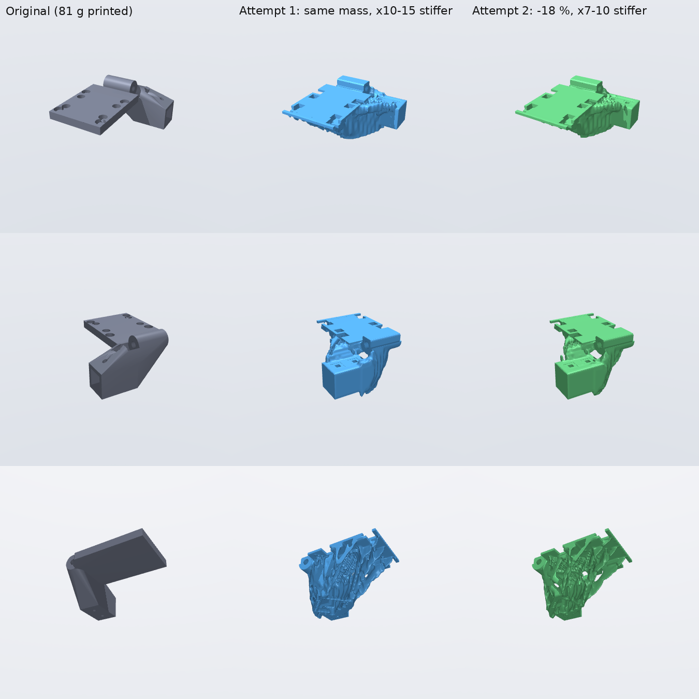

# Generative-design trial: fixed head of the backpack mount

A trial with the generative-design skill (topology optimisation with PyTopo3D + finishing in
Blender) on a single part, `head_fixed`, to see whether it is worth using in the mount.

## Result

| | Original | Attempt 1 (same mass) | Attempt 2 (less material) |
|---|---|---|---|
| Volume (solid mass in PETG) | 132 cm³ (168 g) | 134 cm³ (171 g, +2 %) | 109 cm³ (138 g, −18 %) |
| **Printed with 6 perimeters + 40 % infill** (estimate) | **~125 g** | ~163 g | **~136 g (+9 %)** |
| Stiffness: walk with 500 g | 1 | ×14.7 | ×10.0 |
| Stiffness: walk with a push to the left / right | 1 | ×12.2 / ×10.5 | ×8.4 / ×6.7 |
| Stiffness: branch | 1 | ×11.0 | ×7.5 |
| Stiffness: magnets about to give way | 1 | ×14.2 | ×8.8 |
| Indicative stress (p99) | 1 | ×0.16–0.20 | ×0.24–0.31 |
| Area that needs support when printing | 10 cm² | 97 cm² | 78 cm² |

**Verdict: do not adopt the generative part.** On paper (solid part) it is stiffer and lighter;
printed with infill, the way they are really printed, it weighs the same or more (its thin
branches are almost all perimeter) and it needs ~8 times more support. What it does make clear:
**the original is flexible** (the magnet platform is a 10 mm plate hanging off the hinge) and the
stiffness comes from a **deep web under the platform** that ties it to the tube socket. That can be
drawn by hand on the original part (ribs), without supports and without losing editability.

## Assumptions and limits

- **Loads** (from the backpack simulation, `sim/demo_walk.py`, with a 1.5 margin): walking while
  holding 500 g (24 N at 206 mm in front of the arm base), the same with a sideways push to each
  side, the branch (20 N backwards at the gripper: the most before the magnets give way) and the
  magnets about to give way (100 N against the pin). Details in `problems.py`.
- **Horizontal tube**: for the trial, the tube is parallel to the pin (in the design it rises
  15 mm); the original used for comparison is the same part with that change (`head_fixed_level.scad`).
- **Space**: it was allowed to grow 1.1 cm lower than the original (and 1 cm further back); it would
  need to be confirmed that this space is free behind the shoulder.
- Stiffness and stress are **ratios in a 3 mm voxel model** (both parts solid), not safety
  factors. The printed mass is an estimate (0.5 mm voxels).
- The clean-up ran on a 0.5 mm grid instead of 0.25 mm (with 0.25 mm the 16 GB of memory was not
  enough for a 13 x 7 x 11 cm part).
- Not tested: real printing, the ideal print orientation, the other mount parts.

## Files

- `problems.py`: the problem (frame, keep-out zones, preserved parts, loads).
- `head_fixed_level.scad` → `baselines/head_fixed.stl`: the original used for comparison.
- `comparison.png`: original and attempts. The meshes of the attempts are kept out of the repo.

## What was done afterwards

What the trial showed was applied by hand: **ribs under the platform and a wall that ties them to
the tube socket** (`cad/mounts.scad`, `head_fixed`). Measured the same way as the generative part,
but with 2.5 mm voxels (with 3 mm the comparison cannot tell 4 mm from 5 mm thicknesses apart):

| | Original | 20 mm ribs | **28 mm ribs (adopted)** | Generative, attempt 2 |
|---|---|---|---|---|
| Solid mass | 168 g | 173 g (+3 %) | 184 g (+10 %) | 138 g (−18 %) |
| Printed (6 perimeters + 40 %) | ~105 g | ~115 g | **~124 g** | more than the original |
| Stiffness (all 5 cases) | 1 | ×2.5–3.0 | **×3.1–4.2** | ×3.8–6.1 |
| Indicative stress | 1 | ×0.52–0.58 | **×0.39–0.44** | — |
| Goes outside the original's bounding box | — | no | no | yes (1.1 cm) |

With 2.5 mm voxels the advantage of the generative part shrinks (×3.8–6.1 instead of ×6.7–10 with
3 mm). `problems.py` has `head_fixed_ribs` to repeat the evaluation:
`openscad -o out/head_fixed_ribs.stl head_fixed_level.scad` and then `evaluate.py problems.py
head_fixed_ribs 2.5`.
